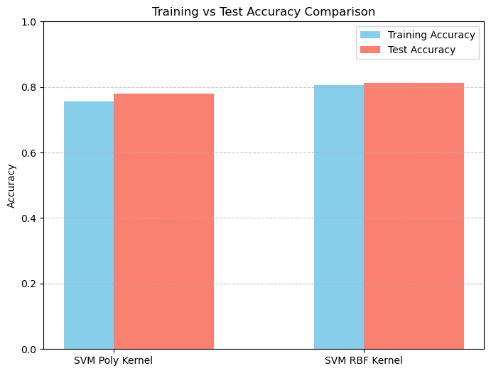
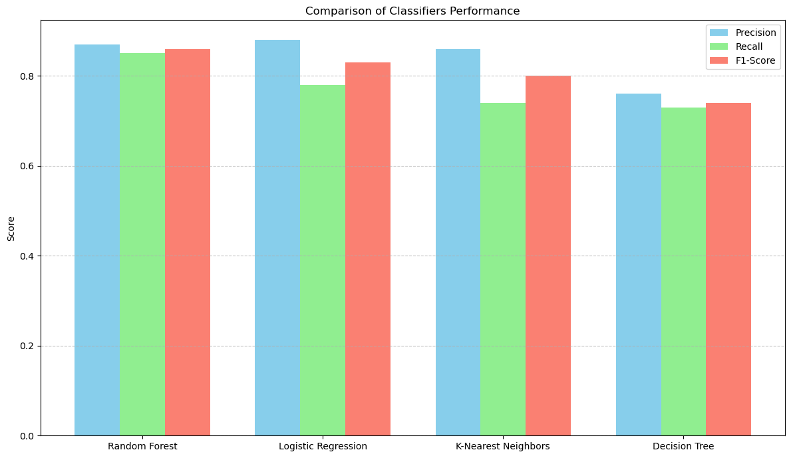

# Diabetes Classification with Nonlinear SVM

An individual academic project: Python experiments on the Pima Indians Diabetes dataset: **polynomial and RBF Support Vector Machines**, compared with Random Forest, Logistic Regression, K-Nearest Neighbors and Decision Tree, using SMOTE for class imbalance and `SelectKBest` for feature selection.

> This is an academic classification project, **not a diagnostic tool**. Figures below are **results reported by the notebook in its original run**, not independently verified benchmarks, and the model must not be used for medical decisions.

**Stack:** Python · pandas · NumPy · scikit-learn · imbalanced-learn · Matplotlib/Seaborn · Jupyter

## Project at a glance

| | |
|---|---|
| Task | Binary classification (`Outcome`: 0 = no diabetes, 1 = diabetes) |
| Data | 768 rows × 8 features + `Outcome` (500 negative / 268 positive) |
| Models | SVC (poly, RBF), Random Forest, Logistic Regression, KNN, Decision Tree |
| Notebook | [`Diabetes-Classification-Nonlinear-SVM.ipynb`](Diabetes-Classification-Nonlinear-SVM.ipynb) |

## Dataset

The notebook reads a local file named `diabetes - Copy.csv`, which is **not included** in this repository. The columns are `Pregnancies`, `Glucose`, `BloodPressure`, `SkinThickness`, `Insulin`, `BMI`, `DiabetesPedigreeFunction`, `Age` and `Outcome`, of the **Pima Indians Diabetes dataset** (originally from the National Institute of Diabetes and Digestive and Kidney Diseases; copies are available from public sources such as the UCI Machine Learning Repository and Kaggle).

To run it, obtain a copy of the dataset from a public source (check its terms of use), save it next to the notebook as `diabetes - Copy.csv` or change the path in the `pd.read_csv` cell. `.gitignore` excludes `diabetes*.csv` so the data is not committed by accident.

## Workflow

1. **Exploration:** shape, dtypes, summary statistics, class balance, per-class means, feature histograms.
2. **Standardization:** `StandardScaler` on the feature matrix.
3. **Split:** stratified 80/20 (`random_state=16`) → 614 training / 154 test rows.
4. **Imbalance handling:** SMOTE on the training set only → 400 / 400.
5. **Feature selection:** `SelectKBest(mutual_info_classif, k=6)` keeps Pregnancies, Glucose, BloodPressure, SkinThickness, BMI and Age.
6. **Nonlinear SVMs:** `SVC` with polynomial and RBF kernels (`C=1.0`).
7. **Model comparison:** Random Forest, Logistic Regression, KNN and Decision Tree with default settings.
8. **Tuning:** `GridSearchCV` (5-fold) for Decision Tree and KNN.
9. **Prediction demo:** a single hand-entered record run through the scaler, selector and SVMs.

## Results reported by the notebook

Evaluated on the 154-row hold-out set.

| Model | Test accuracy | Class-1 (diabetes) precision / recall |
|---|---|---|
| SVM, RBF kernel | 0.8117 | 0.69 / 0.83 |
| SVM, polynomial kernel | 0.7792 | 0.75 / 0.56 |
| Random Forest | 0.82 | 0.73 / 0.76 |
| Logistic Regression | 0.79 | 0.66 / 0.80 |
| KNN | 0.75 | 0.62 / 0.78 |
| Decision Tree | 0.68 | 0.53 / 0.57 |
| Decision Tree, tuned | 0.7468 | not printed |
| KNN, tuned | 0.7208 | not printed |




The decision-tree and random-forest models take no explicit `random_state`; the notebook only sets a global NumPy seed, so exact numbers may vary across library versions.

## Limitations

- The scaler is fitted on the full dataset before the train/test split, which leaks a small amount of test-set statistics into training.
- Zero values in clinical columns such as Glucose, BloodPressure, SkinThickness, Insulin and BMI are kept as-is rather than treated as missing.
- Results come from a single 154-row hold-out split with no cross-validation of the SVMs, and the same test set is used to compare models.
- The later polynomial-SVM experiment (k=7) re-splits and re-scales data in a way that makes its printed accuracy (0.7662) not directly comparable with the earlier results.
- Some chart values were typed in manually from printed reports.

## Setup

```bash
pip install -r requirements.txt
jupyter lab   # or: jupyter notebook
```

Place the dataset CSV as described above, then run the cells in order. The original run used a local Anaconda environment; the package versions seen in its output are listed in `requirements.txt`. This setup has not been re-tested for this repository.

## Repository structure

```
Diabetes-Classification-Nonlinear-SVM/
├── Diabetes-Classification-Nonlinear-SVM.ipynb   # notebook with original code and saved outputs
├── assets/                                       # figures extracted from the notebook outputs
├── requirements.txt
└── README.md
```

The notebook code and results are unchanged. Markdown documentation cells were added, and the output of the `pip install` cell was cleared because it exposed a local machine path. Some code comments are in Arabic.
